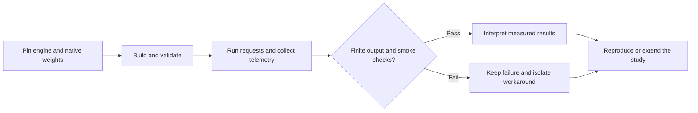

# GLM-5.3-Flash native int4 on Jetson Thor

A reproducible study of Colibri's SSD-backed mixture-of-experts inference on a
128 GB NVIDIA Jetson Thor. The question is whether a roughly **195 GB native
checkpoint** can run usefully when only part of its experts fit in shared memory,
and where the time goes: storage, expert computation, attention, or prompt processing.

This is an experiment in running a model larger than RAM. It does not substitute
a smaller GGUF for the native checkpoint, and it does not assume the outcome.

<!-- STATUS START -->
**Current status:** 3 full-model attempt(s) recorded, 2 completed. See [results](docs/RESULTS.md) for measurements and failures.
<!-- STATUS END -->

## What you can get from this repository

| You want to… | Start here | Evidence or tool |
|---|---|---|
| Run a 195 GB native checkpoint on a 128 GB-class machine | [Reproduce the study](docs/REPRODUCE.md) | Pinned revisions, verified download, and explicit resource budgets |
| Understand the CPU/GPU/SSD arrangement | [Architecture](docs/ARCHITECTURE.md) | Shared-memory and measurement-flow diagrams |
| See the measured behavior and its limits | [Results](docs/RESULTS.md) | Charts, exact HTTP attempts, quality checks, and phase/I/O counters |
| Diagnose incorrect output before trusting speed | [Diagnostics](docs/DIAGNOSTICS.md) | Matched default/conservative CUDA probes and recorded fixes |
| Try questions or extend the benchmark | [Interactive chat](docs/INTERACTIVE.md) · [Next experiments](docs/NEXT_EXPERIMENTS.md) | Scripts, prompts, regression tests, and follow-up controls |
| Find a specific file or deeper detail | [Complete file index](docs/INDEX.md) | Every public tracked file linked with its purpose |




The graph reports whole-batch HTTP completion throughput, not steady decode
speed. Dots are four requests within one server start per configuration. The
default CUDA failure is excluded from the performance comparison. Read the
[metric definitions and limits](docs/METHODOLOGY.md) before comparing systems.

## Study map

- [Step-by-step lab notebook](docs/LAB_NOTES.md): actions, observations, and decisions.
- [Architecture and evidence flow](docs/ARCHITECTURE.md): how weights, requests, and measurements move.
- [Complete linked file index](docs/INDEX.md): descriptions and links for every public file.
- [Try it yourself](docs/INTERACTIVE.md): interactive terminal chat and CPU/CUDA selection.
- [Reproduction guide](docs/REPRODUCE.md): exact setup and run commands.
- [Benchmark protocol](docs/METHODOLOGY.md): controls, metrics, and limitations.
- [Results](docs/RESULTS.md): generated table, including failed attempts.
- [First full-model diagnostics](docs/DIAGNOSTICS.md): CUDA corruption, matched
  CPU/CUDA controls, the conservative workaround, and runner corrections.
- [Issues, fixes, and PR context](docs/ISSUES_AND_PRS.md): tracked findings,
  reproduction evidence, implemented fixes, and related upstream work.
- [Next experiments](docs/NEXT_EXPERIMENTS.md): how to extend the initial study.
- [References](docs/REFERENCES.md): upstream documentation and first-person tests.

## Pinned inputs

| Input | Value |
|---|---|
| Engine | Colibri v2.2.0 |
| Engine commit | `e479104ae01bdc40ce81e675299b1d230891b321` |
| Model | `Justvugg/GLM-5.3-Flash-colibri-int4-g64` |
| Model revision | `fe1d408f252c9c53a0d688aa54e41d9bdfdfd510` |
| Model size | 194,747,643,763 bytes, including repository metadata |
| Weight shards | 62 safetensors files |
| Routed experts | Native group-scaled int4, group size 64 |
| Initial dense-weight precision | `GLM53_BITS=4`, a separate runtime setting |
| CUDA architecture | `sm_110` |
| Initial context / concurrency | 8,192 tokens / one request |

The native container keeps non-expert source weights in BF16; the engine's
`GLM53_BITS` setting controls their runtime representation. The model is a
third-party requantization of Z.ai's weights, not an official int4 checkpoint.

## Initial comparison

The completed short HTTP study measured **0.415 completion tok/s on CPU** and
**0.517 with conservative CUDA**, including prefill and request overhead. Both
passed the two known-answer smoke checks. The default CUDA path produced
non-finite logits and is excluded from useful-output performance. This is one
machine and a small workload, not a general performance ranking.

| Profile | Backend | RAM expert-cache budget | Device expert-tier budget |
|---|---|---:|---:|
| `cpu-32` | CPU, same CUDA-capable executable with GPU disabled | 32 decimal GB | 0 |
| `cuda-16-32` | CUDA | 32 decimal GB | 16 GiB |
| `cuda-32-32` | CUDA, optional follow-up | 32 decimal GB | 32 GiB |
| `cuda-conservative-16-32` | CUDA with tensor-core GEMMs disabled | 32 decimal GB | 16 GiB requested |

Thor shares memory between CPU and GPU. Device allocations consume the same
physical pool as the RAM expert cache. Explicit limits, a disabled extra host
pool, and a memory monitor keep the first experiment conservative.

These profiles change both expert residency and computation. An observed
difference would be a whole-configuration result, not an isolated kernel speedup.

## Run

Prerequisites already available on the study machine: Python 3.12, Git, GCC,
make, OpenMP, NVIDIA drivers, and CUDA 13.2. The lab scripts use Python's standard
library and Colibri's pinned downloader and HTTP benchmark. They do not install
system packages.

The optional sampled native-expert arithmetic check uses the machine's existing
NumPy. Docker's CLI verifies preservation of this host's containers.

```bash
bash scripts/setup.sh
python3 scripts/capture_environment.py
python3 scripts/download_model.py --workers 4
python3 scripts/validate_model.py
python3 scripts/run_experiment.py --profile cpu-32 --quality
python3 scripts/run_experiment.py --profile cuda-conservative-16-32 --quality
python3 scripts/summarize.py
python3 scripts/render_docs.py  # optional Matplotlib dependency
```

The model download is approximately 195 GB. It is resumable and verified against
the pinned repository's checksums. Keep at least 50 GiB free after staging it.
Use [the detailed guide](docs/REPRODUCE.md) to run the campaign unattended and
inspect progress with `python3 scripts/status.py`.

## Rebuild the documentation figures without downloading the model

The committed charts can be regenerated on a machine with Python and Matplotlib;
no GPU, model weights, or private logs are required:

```bash
python3 scripts/render_docs.py
```

For an isolated plotting environment, see [chart reproduction](docs/ARCHITECTURE.md#rebuild-the-charts-and-file-index).
The [figure manifest](docs/assets/figures.json) records the input-data hash,
renderer version, and exported SVG/PNG files. The inference scripts keep their
standard-library dependency boundary.

## Repository boundaries

Tracked: configuration, model manifest, workloads, lab scripts, methods, build
evidence, and selected results. Ignored: weights, upstream checkout, process
state, raw logs, the local PDF, and unrelated machine-administration records. The scripts
never publish or push the repository automatically.

Colibri is Apache-2.0 licensed. The selected model is MIT licensed by its model
publishers. Their code and weights remain separate, with their original licenses
and attribution; this repository records the experiment.
