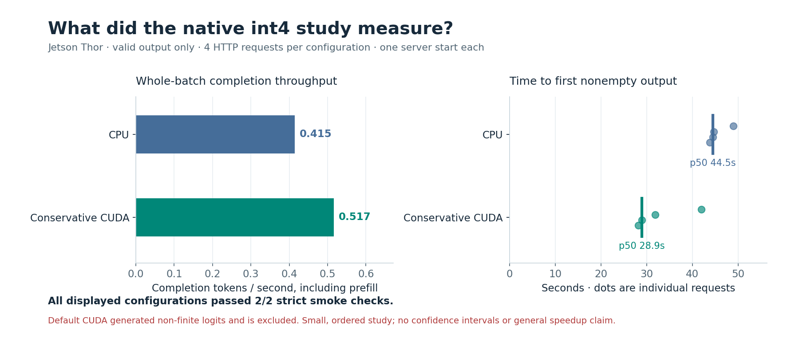
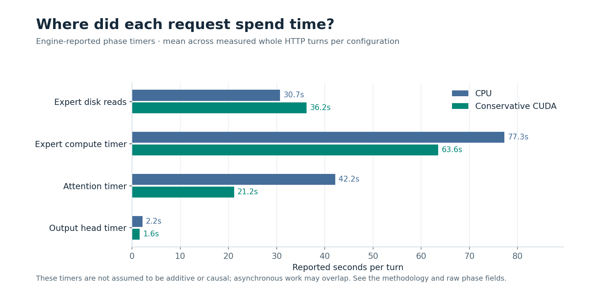
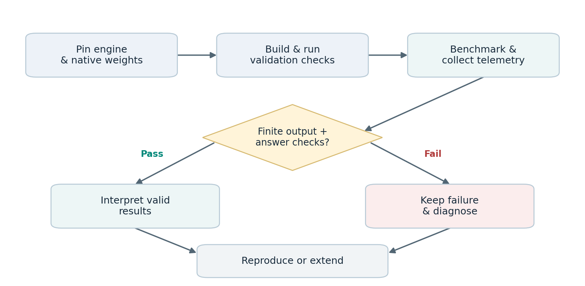

# GLM-5.3-Flash native int4 on Jetson Thor

**A 195 GB native int4 checkpoint on one 128 GB NVIDIA Jetson Thor.**
This study tests Colibri's SSD-backed expert streaming, compares CPU and CUDA,
and measures how long you wait for output when the model exceeds RAM.

[Results](#benchmark-results) · [Run it](#run) · [How it works](docs/ARCHITECTURE.md) · [All files](docs/INDEX.md)



## Benchmark results

<!-- METRICS START -->

| Measured metric | CPU | Conservative CUDA |
|---|---:|---:|
| **Completion throughput** | **0.415 tok/s** | **0.517 tok/s** |
| **TTFT proxy — p50** | **44.47 s** | **28.94 s** |
| TTFT proxy — observed range | 43.85–48.98 s | 28.22–41.96 s |
| Full request duration — p50 | 153.09 s | 114.77 s |
| Model/server startup | 37.06 s | 39.44 s |
| Known-answer smoke checks | 2/2 passed | 2/2 passed |
| Measured HTTP requests / reported completion tokens | 4 / 256 | 4 / 256 |
| Storage reads during measured requests | 377.1 GB | 365.9 GB |
| Lowest global available memory during the run | 75.55 GiB | 53.81 GiB |

<!-- METRICS END -->

**What this demonstrates:** the native checkpoint runs with CPU or conservative
CUDA at this operating point, and both pass the two known-answer checks. Output
is slow: the valid CUDA configuration took about **29 seconds to first output**
and delivered **0.517 completion tokens/s** over the measured batch.

**Metric definitions:** throughput includes prefill and HTTP overhead.
**TTFT proxy** means time to the first nonempty streamed output, which can be
reasoning content; the benchmark does not record exact first-token timing,
per-token latency, or steady-state decode speed. Four requests within one server
start per configuration are correlated observations. Conservative CUDA uses
`COLI_CUDA_TC_GEMM=0`. The default CUDA attempt produced non-finite logits and
is excluded from the useful-output comparison.

[Full results and failed attempts](docs/RESULTS.md) · [Metric definitions and controls](docs/METHODOLOGY.md) · [Machine-readable measurements](results/summary.json)

## Where the time goes



The expert-compute timer is the largest displayed counter in both valid
configurations. Conservative CUDA reports lower expert-compute and attention
times, while its expert-disk timer is higher. These phase timers can overlap;
their sum is not a wall-time breakdown.
[Phase interpretation and limitations](docs/RESULTS.md#reported-phase-times).

## What SSD streaming and memory placement look like


The failed CUDA attempt requested a 16 GiB expert tier but reported **1.54 GiB**;
the valid conservative attempt reported **16.00 GiB**. CPU and GPU allocations
share Thor's physical memory. The roughly **366–377 GB read per measured batch**
includes repeated reads of the 195 GB checkpoint.
[Memory and I/O interpretation](docs/RESULTS.md#placement-and-storage-reads) · [Architecture diagram](docs/ARCHITECTURE.md).

<!-- STATUS START -->
**Current status:** 3 full-model attempt(s) recorded, 2 completed. See [results](docs/RESULTS.md) for measurements and failures.
<!-- STATUS END -->

## What you can get from this repository

| You want to… | Start here | Evidence or tool |
|---|---|---|
| Run a 195 GB native checkpoint on a 128 GB-class machine | [Reproduce the study](docs/REPRODUCE.md) | Pinned revisions, verified download, and explicit resource budgets |
| Understand the CPU/GPU/SSD arrangement | [Architecture](docs/ARCHITECTURE.md) | Shared-memory and measurement-flow diagrams |
| See the measured behavior and its limits | [Results](docs/RESULTS.md) | Charts, exact HTTP attempts, quality checks, and phase/I/O counters |
| Diagnose incorrect output before trusting speed | [Diagnostics](docs/DIAGNOSTICS.md) | Matched default/conservative CUDA probes and recorded fixes |
| Try questions or extend the benchmark | [Interactive chat](docs/INTERACTIVE.md) · [Next experiments](docs/NEXT_EXPERIMENTS.md) | Scripts, prompts, regression tests, and follow-up controls |
| Find a specific file or deeper detail | [Complete file index](docs/INDEX.md) | Every public tracked file linked with its purpose |

**Study workflow**



[Full architecture and evidence flow](docs/ARCHITECTURE.md) · [Scalable workflow image](docs/assets/study-workflow.svg)

## Study map

- [Step-by-step lab notebook](docs/LAB_NOTES.md): actions, observations, and decisions.
- [Architecture and evidence flow](docs/ARCHITECTURE.md): how weights, requests, and measurements move.
- [Complete linked file index](docs/INDEX.md): descriptions and links for every public file.
- [Try it yourself](docs/INTERACTIVE.md): interactive terminal chat and CPU/CUDA selection.
- [Reproduction guide](docs/REPRODUCE.md): exact setup and run commands.
- [Benchmark protocol](docs/METHODOLOGY.md): controls, metrics, and limitations.
- [Results](docs/RESULTS.md): generated table, including failed attempts.
- [First full-model diagnostics](docs/DIAGNOSTICS.md): CUDA corruption, matched
  CPU/CUDA controls, the conservative workaround, and runner corrections.
- [Issues, fixes, and PR context](docs/ISSUES_AND_PRS.md): tracked findings,
  reproduction evidence, implemented fixes, and related upstream work.
- [Next experiments](docs/NEXT_EXPERIMENTS.md): how to extend the initial study.
- [References](docs/REFERENCES.md): upstream documentation and first-person tests.

## Pinned inputs

| Input | Value |
|---|---|
| Engine | Colibri v2.2.0 |
| Engine commit | `e479104ae01bdc40ce81e675299b1d230891b321` |
| Model | `Justvugg/GLM-5.3-Flash-colibri-int4-g64` |
| Model revision | `fe1d408f252c9c53a0d688aa54e41d9bdfdfd510` |
| Model size | 194,747,643,763 bytes, including repository metadata |
| Weight shards | 62 safetensors files |
| Routed experts | Native group-scaled int4, group size 64 |
| Initial dense-weight precision | `GLM53_BITS=4`, a separate runtime setting |
| CUDA architecture | `sm_110` |
| Initial context / concurrency | 8,192 tokens / one request |

The native container keeps non-expert source weights in BF16; the engine's
`GLM53_BITS` setting controls their runtime representation. The model is a
third-party requantization of Z.ai's weights, not an official int4 checkpoint.

## Experiment configurations

| Profile | Backend | RAM expert-cache budget | Device expert-tier budget |
|---|---|---:|---:|
| `cpu-32` | CPU, same CUDA-capable executable with GPU disabled | 32 decimal GB | 0 |
| `cuda-16-32` | CUDA | 32 decimal GB | 16 GiB |
| `cuda-32-32` | CUDA, optional follow-up | 32 decimal GB | 32 GiB |
| `cuda-conservative-16-32` | CUDA with tensor-core GEMMs disabled | 32 decimal GB | 16 GiB requested |

Thor shares memory between CPU and GPU. Device allocations consume the same
physical pool as the RAM expert cache. Explicit limits, a disabled extra host
pool, and a memory monitor keep the first experiment conservative.

These profiles change both expert residency and computation. An observed
difference would be a whole-configuration result, not an isolated kernel speedup.

## Run

Prerequisites already available on the study machine: Python 3.12, Git, GCC,
make, OpenMP, NVIDIA drivers, and CUDA 13.2. The lab scripts use Python's standard
library and Colibri's pinned downloader and HTTP benchmark. They do not install
system packages.

The optional sampled native-expert arithmetic check uses the machine's existing
NumPy. Docker's CLI verifies preservation of this host's containers.

```bash
bash scripts/setup.sh
python3 scripts/capture_environment.py
python3 scripts/download_model.py --workers 4
python3 scripts/validate_model.py
python3 scripts/run_experiment.py --profile cpu-32 --quality
python3 scripts/run_experiment.py --profile cuda-conservative-16-32 --quality
python3 scripts/summarize.py
python3 scripts/render_docs.py  # optional Matplotlib dependency
```

The model download is approximately 195 GB. It is resumable and verified against
the pinned repository's checksums. Keep at least 50 GiB free after staging it.
Use [the detailed guide](docs/REPRODUCE.md) to run the campaign unattended and
inspect progress with `python3 scripts/status.py`.

## Rebuild the documentation figures without downloading the model

The committed charts can be regenerated on a machine with Python and Matplotlib;
no GPU, model weights, or private logs are required:

```bash
python3 scripts/render_docs.py
```

For an isolated plotting environment, see [chart reproduction](docs/ARCHITECTURE.md#rebuild-the-charts-and-file-index).
The [figure manifest](docs/assets/figures.json) records the input-data hash,
renderer version, and exported SVG/PNG files. The inference scripts keep their
standard-library dependency boundary.

## Repository boundaries

Tracked: configuration, model manifest, workloads, lab scripts, methods, build
evidence, and selected results. Ignored: weights, upstream checkout, process
state, raw logs, the local PDF, and unrelated machine-administration records. The scripts
never publish or push the repository automatically.

Colibri is Apache-2.0 licensed. The selected model is MIT licensed by its model
publishers. Their code and weights remain separate, with their original licenses
and attribution; this repository records the experiment.

## License

This project's original code and documentation are licensed under the [Apache License 2.0](LICENSE).

Colibri and the GLM-5.3-Flash model are third-party components governed by their respective licenses.
