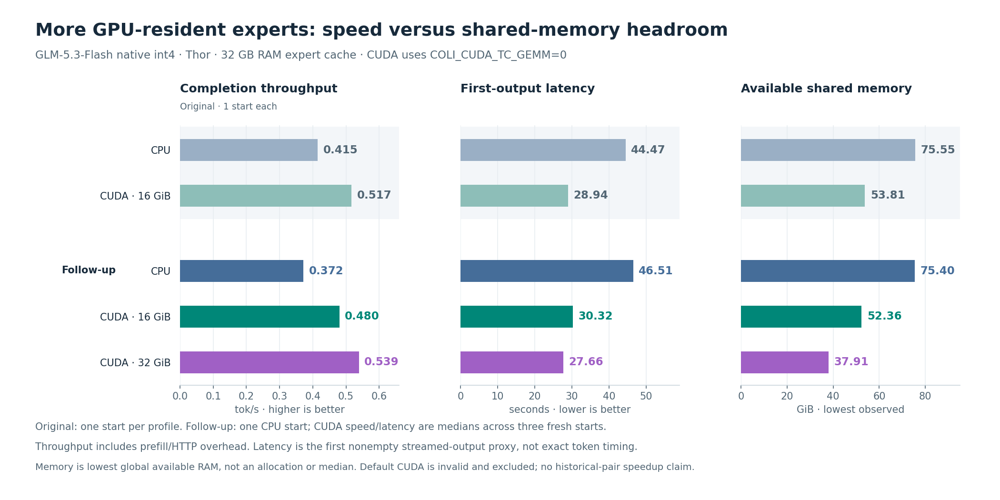
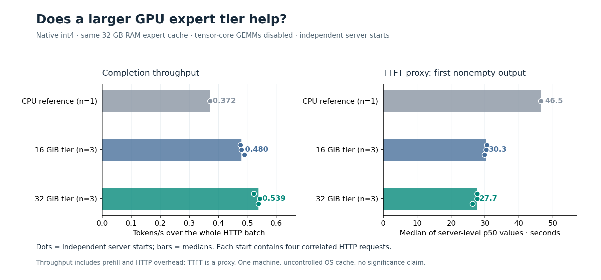
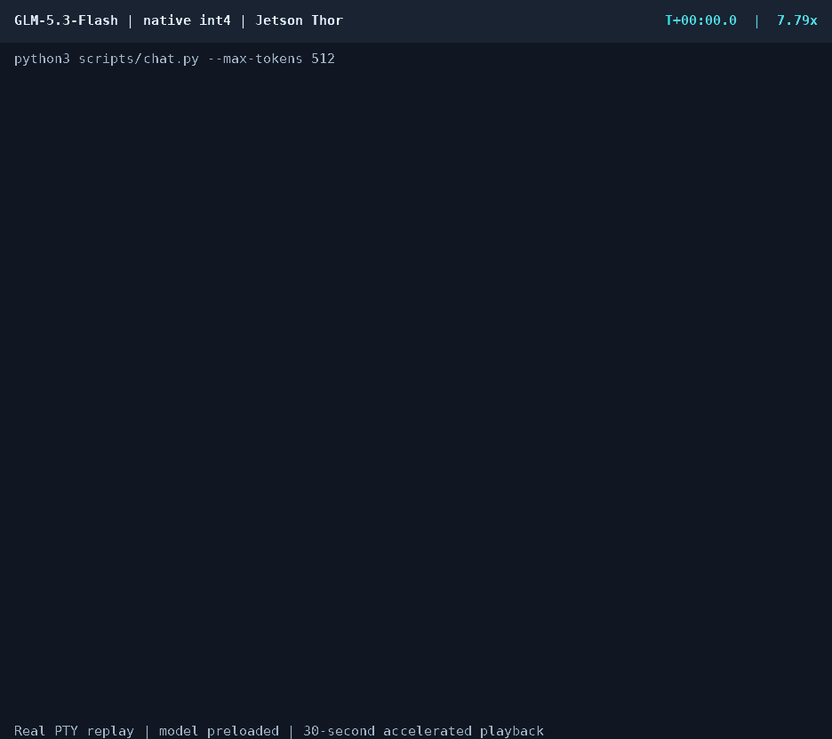
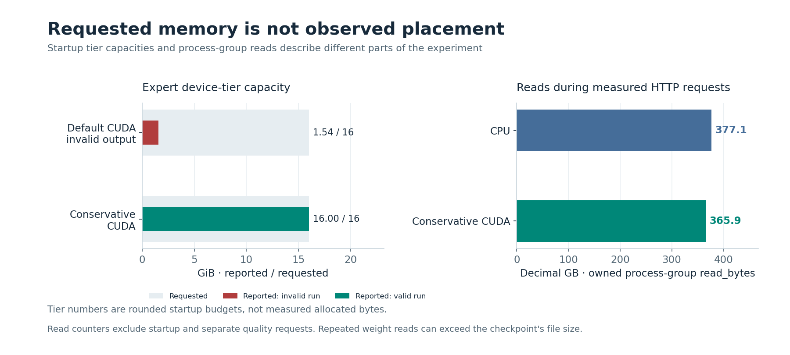

# GLM-5.3-Flash native int4 on Jetson Thor

**A 195 GB native int4 model on one 128 GB NVIDIA Jetson Thor.**
This repository measures GLM-5.3-Flash with Colibri's SSD-backed expert streaming:
weights stay on NVMe, a bounded RAM cache holds experts, and an optional GPU
expert tier trades shared memory for faster computation. The aim is to show
what runs correctly, how long output takes, and what each configuration costs.

[Comparison](#comparison-at-a-glance) · [Benchmarks](#benchmark-results) · [16 → 32 GiB tuning](#tuning-history) · [Rust demos](#watch-glm-write-rust-in-30-seconds) · [Run it](#run) · [All files](docs/INDEX.md) · [Conclusion](#conclusion)

## Setting and benchmark plan

The host is **shockwave-01, a Jetson AGX Thor** with one shared CPU/GPU memory
pool (122.7 GiB reported usable RAM), 14 available CPU threads, a 1 TB WD NVMe,
no swap, and the existing 120 W power profile. The engine is pinned to
**Colibri v2.2.0**, using native group-64 int4 experts and runtime dense precision
of 4 bits. Every performance configuration uses a **32 decimal GB RAM expert
cache**, an 8,192-token context, and one request at a time.
[Exact hardware and software](results/environment.json) · [Pinned inputs](#pinned-inputs).

The study follows these questions in order. GPU-tier budgets are **GiB**;
the RAM-cache budget is decimal **GB**. Both consume the same physical RAM.

| Benchmark | Setting | Why test it? | Trade-off / observed result |
|---|---|---|---|
| **1. CPU reference** | GPU disabled; 32 GB RAM expert cache | Establish useful output and a reference for CUDA | Largest memory headroom; slowest output in these runs |
| **2. Default CUDA diagnostic** | 16 GiB GPU expert tier; default tensor-core GEMMs | Check correctness before trusting speed | Non-finite logits; invalid output, excluded from speed charts |
| **3. Conservative CUDA baseline** | 16 GiB GPU expert tier; `COLI_CUDA_TC_GEMM=0` | Measure a working GPU configuration against CPU | Faster first output, but less available shared memory |
| **4. Tunning-Enhance-1** | Conservative CUDA, 16 versus 32 GiB; RAM cache stays 32 GB | Test whether more GPU-resident experts help across three matched pairs | Modest improvement, lower memory headroom, and longer startup |
| **5. Rust Fibonacci demonstrations** | One real chat session at each GPU budget; same question and 512-token cap | Show the actual wait and terminal response | Both take about 210–212 seconds; GIFs accelerate playback, not inference |

The original benchmark (2026-11-25 UTC) has one CPU and one valid 16 GiB CUDA
server start, plus the failed default-CUDA attempt. The follow-up (2026-11-26
UTC) repeats the CPU reference once and runs **three fresh 16/32 GiB pairs** in
alternating order. Each successful performance start measures four HTTP requests with a 64-token cap
and two separate arithmetic/sorting checks. These are short workload and
correctness checks, not a broad model-quality evaluation.

## Comparison at a glance



**Read the two groups separately:** historical bars are single server starts;
follow-up CUDA speed and latency bars are medians across three starts; the CPU bar
is one reference start. Memory is the lowest global available value observed,
not a model allocation measurement. [Chart data and provenance](docs/assets/benchmark-comparison.json).

In the matched follow-up, the **32 GiB tier improves median paired throughput
by 9.8% and reduces first-output latency by 9.3%**. It leaves **37.91 GiB** of
minimum observed available RAM versus **52.36 GiB** for 16 GiB, and median
startup rises from **42.06 to 44.45 seconds**. This is below the predeclared
20% considerable-gain target; both configurations and all historical results
are retained. The chart's profile medians and the median of paired percentage
changes are different summaries; gains are computed only from fresh matched pairs.

**Metric scope:** completion tok/s includes prefill and HTTP overhead. The
**TTFT proxy** is time to first nonempty streamed output, possibly reasoning;
exact first-token timing, inter-token latency, and steady-state decode speed
were not measured. Three pairs on one host with uncontrolled OS caches and
background services provide descriptive results, not a significance claim.

## Benchmark results

### 1. CPU reference

CPU-only execution establishes a useful-output reference without a GPU expert
tier. The original start delivered **0.415 completion tok/s** with **44.47 seconds**
to first output (p50); the fresh follow-up reference delivered **0.372 tok/s**
and **46.51 seconds**. Each is one server start, so their difference is not a
controlled regression result. The CPU run retained about **75 GiB** of minimum
available memory, more headroom than either CUDA configuration.

### 2. Default CUDA: correctness before speed

The default 16 GiB CUDA attempt produced non-finite logits and invalid output.
It also reported only 1.54 GiB of the requested expert tier. Matched diagnostic
probes established `COLI_CUDA_TC_GEMM=0` as the working workaround used for both
valid GPU budgets. The underlying kernel issue remains open; the workaround
is not a kernel fix. [Diagnostic evidence](docs/DIAGNOSTICS.md) · [Issues and fixes](docs/ISSUES_AND_PRS.md).

### 3. Conservative 16 GiB CUDA baseline

**Original benchmark — 2026-11-25 UTC, one server start per configuration.**


<!-- METRICS START -->

| Measured metric | CPU | Conservative CUDA |
|---|---:|---:|
| **Completion throughput** | **0.415 tok/s** | **0.517 tok/s** |
| **TTFT proxy — p50** | **44.47 s** | **28.94 s** |
| TTFT proxy — observed range | 43.85–48.98 s | 28.22–41.96 s |
| Full request duration — p50 | 153.09 s | 114.77 s |
| Model/server startup | 37.06 s | 39.44 s |
| Known-answer smoke checks | 2/2 passed | 2/2 passed |
| Measured HTTP requests / reported completion tokens | 4 / 256 | 4 / 256 |
| Storage reads during measured requests | 377.1 GB | 365.9 GB |
| Lowest global available memory during the run | 75.55 GiB | 53.81 GiB |

<!-- METRICS END -->

**What this demonstrates:** the native checkpoint runs with CPU or conservative
CUDA at this operating point, and both pass the two known-answer checks. Output
is slow: the valid CUDA configuration took about **29 seconds to first output**
and delivered **0.517 completion tokens/s** over the measured batch.

**Metric definitions:** throughput includes prefill and HTTP overhead.
**TTFT proxy** means time to the first nonempty streamed output, which can be
reasoning content; the benchmark does not record exact first-token timing,
per-token latency, or steady-state decode speed. Four requests within one server
start per configuration are correlated observations. Conservative CUDA uses
`COLI_CUDA_TC_GEMM=0`. The default CUDA attempt produced non-finite logits and
is excluded from the useful-output comparison.

[Full results and failed attempts](docs/RESULTS.md) · [Metric definitions and controls](docs/METHODOLOGY.md) · [Machine-readable measurements](results/summary.json)

<!-- TUNING ENHANCE 1 START -->

## Tuning history

Every experiment keeps its own inputs, results, charts, and real terminal recording. The original benchmark is retained.

| Study | Date (UTC) | Configuration and scope | Evidence |
|---|---|---|---|
| Original benchmark | 2026-11-25 | CPU and 16 GiB GPU tier, one server start each | [Original results](docs/RESULTS.md) |
| Tunning-Enhance-1 | 2026-11-26 | GPU tier 16 → 32 GiB; RAM cache fixed at 32 GB; three matched pairs | [Complete study](Tunning-Enhance-1/README.md) |

### 4. Tunning-Enhance-1: 16 versus 32 GiB GPU expert tier

**32 GiB GPU expert tier: +9.8% paired median completion throughput; +9.3% reduction in first-output latency.**
Below the predeclared 20% considerable-gain target; retained as a documented tuning result.

Three fresh paired trials compare 16 versus 32 GiB on the same Thor, with the RAM expert cache held at 32 decimal GB and the conservative CUDA workaround retained.



| Measured metric | Historical 16 GiB | Fresh 16 GiB control | Fresh 32 GiB tuning |
|---|---:|---:|---:|
| **Batch completion throughput** | **0.517 tok/s** | **0.480 tok/s** | **0.539 tok/s** |
| **Server TTFT-proxy p50** | **28.94 s** | **30.32 s** | **27.66 s** |
| Server starts / HTTP requests | 1 / 4 | 3 / 12 | 3 / 12 |
| Known-answer checks | 2/2 | 6/6 | 6/6 |
| Model/server startup | 39.44 s | 42.06 s | 44.45 s |
| Approx. startup + first-request output | 81.40 s | 84.42 s | 94.56 s |

The fresh columns summarize three server starts; the historical column is one earlier start. The paired gain uses only the fresh 16/32 GiB runs, not the historical result. Both old and new datasets remain available.

The startup-plus-first-request row adds matching timings and omits validation/harness gaps; it is not an exact command-to-token measurement. [Startup and memory trade-offs](Tunning-Enhance-1/RESULTS.md#memory-io-and-startup-trade-offs).

Throughput includes prefill and HTTP overhead. TTFT is time to first nonempty streamed output, not exact first-token timing. The paired percentages and profile medians summarize different quantities; individual observations and the fixed promotion criterion are linked below. These are measurements on this machine/workload, not a general speedup guarantee.

[Full tuning results](Tunning-Enhance-1/RESULTS.md) · [Paired gains and memory costs](Tunning-Enhance-1/README.md#repeatability-and-cost) · [Method](Tunning-Enhance-1/METHODOLOGY.md) · [All tuning files](Tunning-Enhance-1/INDEX.md)

<!-- TUNING ENHANCE 1 END -->

## Watch GLM write Rust in 30 seconds

### 5. Real chat demonstrations

Both recordings ask for the same iterative Rust Fibonacci program. They show
single preloaded chat sessions, separate from the repeated HTTP benchmark.
Each GIF lasts exactly 30 seconds: 27 seconds of accelerated source events and
a three-second final hold. The clock shows real elapsed source-session time.

### 16 GiB GPU expert tier — 30-second Rust demo


A real `python3 scripts/chat.py --max-tokens 512` session, asking the native
int4 model for an iterative Rust Fibonacci program. Playback is **30 seconds**.
The **212-second session plays at 7.86×** for 27 seconds, followed by a 3-second final hold.
The **top-right clock shows actual elapsed session time** and the playback
multiplier. The recording begins at the ready prompt after model loading.

[Capture details and reproduction](docs/DEMO.md) · [Actual terminal output](results/rust-fibonacci-output.txt) · [Timing and provenance](results/rust-fibonacci-demo.json)

### 32 GiB GPU expert tier — 30-second Rust demo



The same Rust Fibonacci question, recorded with the 32 GiB configuration: **210.3 real seconds at 7.79×**, plus a three-second final hold, for exactly 30 seconds of playback. This single demo is separate from the paired benchmark. [Source and timing](Tunning-Enhance-1/results/rust-fibonacci-demo.json).

Try the 32 GiB study configuration after the [normal model setup](docs/REPRODUCE.md):

```bash
python3 Tunning-Enhance-1/scripts/chat.py --max-tokens 512
```

The 32 GiB session took **210.3 seconds** versus **212.2 seconds** for 16 GiB.
This one coding response shows essentially unchanged waiting time; it does not
demonstrate the paired HTTP benchmark's roughly 10% improvement. The generated
Rust was inspected, not compiled or executed. [Original capture protocol](docs/DEMO.md).

## Where the time goes

**Original benchmark phase measurements.** [Tunning-Enhance-1 phase comparison](Tunning-Enhance-1/assets/phases-and-io.png).


The expert-compute timer is the largest displayed counter in both valid
configurations. Conservative CUDA reports lower expert-compute and attention
times, while its expert-disk timer is higher. These phase timers can overlap;
their sum is not a wall-time breakdown.
[Phase interpretation and limitations](docs/RESULTS.md#reported-phase-times).

## What SSD streaming and memory placement look like

**Original benchmark storage/placement measurements.** [Tunning-Enhance-1 memory and I/O costs](Tunning-Enhance-1/RESULTS.md#memory-io-and-startup-trade-offs).



The failed CUDA attempt requested a 16 GiB expert tier but reported **1.54 GiB**;
the valid conservative attempt reported **16.00 GiB**. CPU and GPU allocations
share Thor's physical memory. The roughly **366–377 GB read per measured batch**
includes repeated reads of the 195 GB checkpoint.
[Memory and I/O interpretation](docs/RESULTS.md#placement-and-storage-reads) · [Architecture diagram](docs/ARCHITECTURE.md).

The following status block covers the original benchmark dataset; the follow-up is listed in the tuning history.

<!-- STATUS START -->
**Current status:** 3 full-model attempt(s) recorded, 2 completed. See [results](docs/RESULTS.md) for measurements and failures.
<!-- STATUS END -->

## What you can get from this repository

| You want to… | Start here | Evidence or tool |
|---|---|---|
| Run a 195 GB native checkpoint on a 128 GB-class machine | [Reproduce the study](docs/REPRODUCE.md) | Pinned revisions, verified download, and explicit resource budgets |
| Understand the CPU/GPU/SSD arrangement | [Architecture](docs/ARCHITECTURE.md) | Shared-memory and measurement-flow diagrams |
| See the measured behavior and its limits | [Results](docs/RESULTS.md) | Charts, exact HTTP attempts, quality checks, and phase/I/O counters |
| Diagnose incorrect output before trusting speed | [Diagnostics](docs/DIAGNOSTICS.md) | Matched default/conservative CUDA probes and recorded fixes |
| Try questions or extend the benchmark | [Interactive chat](docs/INTERACTIVE.md) · [Next experiments](docs/NEXT_EXPERIMENTS.md) | Scripts, prompts, regression tests, and follow-up controls |
| Find a specific file or deeper detail | [Complete file index](docs/INDEX.md) | Every public tracked file linked with its purpose |

**Study workflow**


[Full architecture and evidence flow](docs/ARCHITECTURE.md) · [Scalable workflow image](docs/assets/study-workflow.svg)

## Study map

- [Step-by-step lab notebook](docs/LAB_NOTES.md): actions, observations, and decisions.
- [Architecture and evidence flow](docs/ARCHITECTURE.md): how weights, requests, and measurements move.
- [Complete linked file index](docs/INDEX.md): descriptions and links for every public file.
- [Try it yourself](docs/INTERACTIVE.md): interactive terminal chat and CPU/CUDA selection.
- [Reproduction guide](docs/REPRODUCE.md): exact setup and run commands.
- [Benchmark protocol](docs/METHODOLOGY.md): controls, metrics, and limitations.
- [Results](docs/RESULTS.md): generated table, including failed attempts.
- [First full-model diagnostics](docs/DIAGNOSTICS.md): CUDA corruption, matched
  CPU/CUDA controls, the conservative workaround, and runner corrections.
- [Issues, fixes, and PR context](docs/ISSUES_AND_PRS.md): tracked findings,
  reproduction evidence, implemented fixes, and related upstream work.
- [Next experiments](docs/NEXT_EXPERIMENTS.md): how to extend the initial study.
- [References](docs/REFERENCES.md): upstream documentation and first-person tests.

## Pinned inputs

| Input | Value |
|---|---|
| Engine | Colibri v2.2.0 |
| Engine commit | `e479104ae01bdc40ce81e675299b1d230891b321` |
| Model | `Justvugg/GLM-5.3-Flash-colibri-int4-g64` |
| Model revision | `fe1d408f252c9c53a0d688aa54e41d9bdfdfd510` |
| Model size | 194,747,643,763 bytes, including repository metadata |
| Weight shards | 62 safetensors files |
| Routed experts | Native group-scaled int4, group size 64 |
| Initial dense-weight precision | `GLM53_BITS=4`, a separate runtime setting |
| CUDA architecture | `sm_110` |
| Initial context / concurrency | 8,192 tokens / one request |

The native container keeps non-expert source weights in BF16; the engine's
`GLM53_BITS` setting controls their runtime representation. The model is a
third-party requantization of Z.ai's weights, not an official int4 checkpoint.

## Experiment configurations

| Measured profile | Config file | GPU expert tier | CUDA math |
|---|---|---:|---|
| `cpu-32` | [Original](configs/profiles.json) and [follow-up](Tunning-Enhance-1/configs/profiles.json) | Disabled | CPU reference |
| `cuda-16-32` | [Original](configs/profiles.json) | 16 GiB requested | Default; invalid output |
| `cuda-conservative-16-32` | [Original](configs/profiles.json) and [follow-up](Tunning-Enhance-1/configs/profiles.json) | 16 GiB | `COLI_CUDA_TC_GEMM=0` |
| `cuda-conservative-32-32` | [Follow-up](Tunning-Enhance-1/configs/profiles.json) | 32 GiB | `COLI_CUDA_TC_GEMM=0` |

Every row has the same 32 decimal GB RAM expert-cache budget. The optional
`cuda-32-32` entry in the original config is an unmeasured default-math profile;
it is not the conservative 32 GiB configuration used in the follow-up.
CPU/GPU changes affect both expert residency and computation, so the CPU/CUDA
comparison is a whole-configuration result, not an isolated kernel speedup.

## Run

Prerequisites already available on the study machine: Python 3.12, Git, GCC,
make, OpenMP, NVIDIA drivers, and CUDA 13.2. The lab scripts use Python's standard
library and Colibri's pinned downloader and HTTP benchmark. They do not install
system packages.

The optional sampled native-expert arithmetic check uses the machine's existing
NumPy. Docker's CLI verifies preservation of this host's containers.

```bash
bash scripts/setup.sh
python3 scripts/capture_environment.py
python3 scripts/download_model.py --workers 4
python3 scripts/validate_model.py
python3 scripts/run_experiment.py --profile cpu-32 --quality
python3 scripts/run_experiment.py --profile cuda-conservative-16-32 --quality
python3 scripts/summarize.py
python3 scripts/render_docs.py  # optional Matplotlib dependency
```

The model download is approximately 195 GB. It is resumable and verified against
the pinned repository's checksums. Keep at least 50 GiB free after staging it.
Use [the detailed guide](docs/REPRODUCE.md) to run the original campaign unattended
and inspect progress with `python3 scripts/status.py`. To repeat the complete
16/32 GiB comparison, use the [follow-up reproduction guide](Tunning-Enhance-1/REPRODUCE.md);
it keeps that study's configuration, results, and figures in its own folder.

## Rebuild the documentation figures without downloading the model

The committed charts can be regenerated on a machine with Python and Matplotlib;
no GPU, model weights, or private logs are required:

```bash
python3 scripts/render_docs.py
```

Rebuild the cross-study opening chart from both public summaries:

```bash
python3 scripts/render_comparison.py
```

For an isolated plotting environment, see [chart reproduction](docs/ARCHITECTURE.md#rebuild-the-charts-and-file-index).
The [figure manifest](docs/assets/figures.json) records the input-data hash,
renderer version, and exported SVG/PNG files. The inference scripts keep their
standard-library dependency boundary.

## Repository boundaries

Tracked: configuration, model manifest, workloads, lab scripts, methods, build
evidence, and selected results. Ignored: weights, upstream checkout, process
state, raw logs, the local PDF, and unrelated machine-administration records. The scripts
never publish or push the repository automatically.

Colibri is Apache-2.0 licensed. The selected model is MIT licensed by its model
publishers. Their code and weights remain separate, with their original licenses
and attribution; this repository records the experiment.

## Upstream projects and attribution

This is an independent reproducibility and benchmarking study built on the work of the following upstream projects:

- **[Colibri](https://github.com/JustVugg/colibri)** — inference engine and SSD-backed expert streaming, developed by JustVugg and contributors. This study uses [v2.2.0](https://github.com/JustVugg/colibri/releases/tag/v2.2.0), pinned to [commit e479104](https://github.com/JustVugg/colibri/tree/e479104ae01bdc40ce81e675299b1d230891b321).
- **[Z.ai — GLM-5.3-Flash](https://huggingface.co/zai-org/GLM-5.3-Flash)** — original model and architecture.
- **[Justvugg — GLM-5.3-Flash-colibri-int4-g64](https://huggingface.co/Justvugg/GLM-5.3-Flash-colibri-int4-g64/tree/fe1d408f252c9c53a0d688aa54e41d9bdfdfd510)** — third-party native int4 checkpoint, pinned to revision `fe1d408f252c9c53a0d688aa54e41d9bdfdfd510`.

**This lab's contribution:** independent Jetson AGX Thor integration and reproducibility scripts, CPU/CUDA benchmark methodology and measurements, numerical correctness diagnostics, a validated conservative CUDA workaround, and documented limitations. The workaround is not an upstream kernel fix.

Thanks to the upstream developers and contributors for making this experiment possible. This study is not an official Colibri, Z.ai, or NVIDIA project.

See [References](docs/REFERENCES.md) for additional upstream sources.

## License

This project's original code and documentation are licensed under the [Apache License 2.0](LICENSE).

Colibri and the GLM-5.3-Flash model are third-party components governed by their respective licenses.

## Conclusion

**Colibri runs this 195 GB native int4 checkpoint on one 128 GB-class Thor by
streaming experts from SSD.** CPU and both conservative CUDA budgets pass the
recorded smoke checks; default CUDA fails the numerical gate on this setup.

The 16 GiB GPU tier offers more memory headroom. The 32 GiB tier is the faster
loaded configuration in all three matched pairs, with **9.8% median paired
throughput gain** and **9.3% lower first-output latency**, at the cost of less
available memory and longer startup. The separate Rust demonstrations remain
around **3.5 minutes** each. Neither configuration delivers a fast interactive
chat experience on this workload.

These gains fall below the declared 20% performance-release target. Both
results document the trade-off; neither establishes a universal winner.
Broader workloads and more repeated trials are needed before generalizing;
see [next experiments](docs/NEXT_EXPERIMENTS.md) and the
[complete tuning evidence](Tunning-Enhance-1/RESULTS.md).
