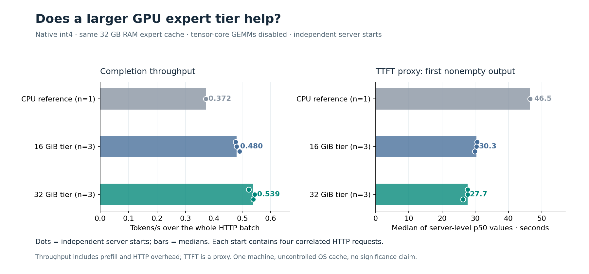
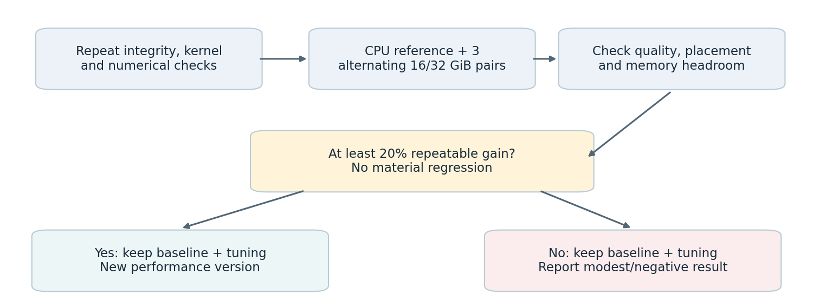
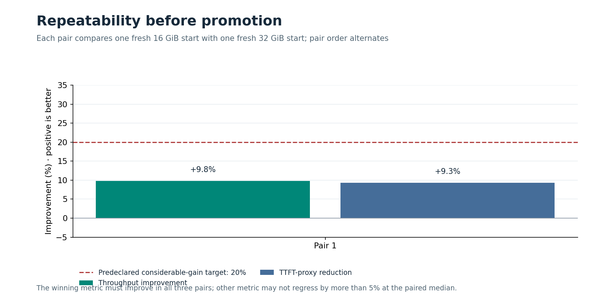
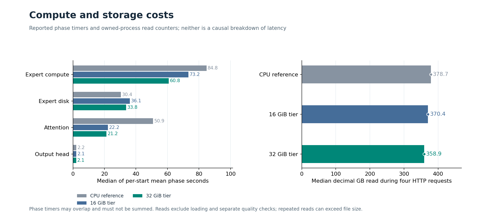
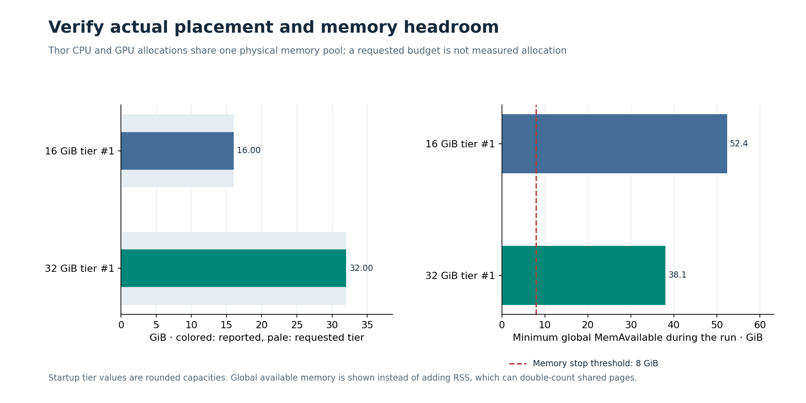
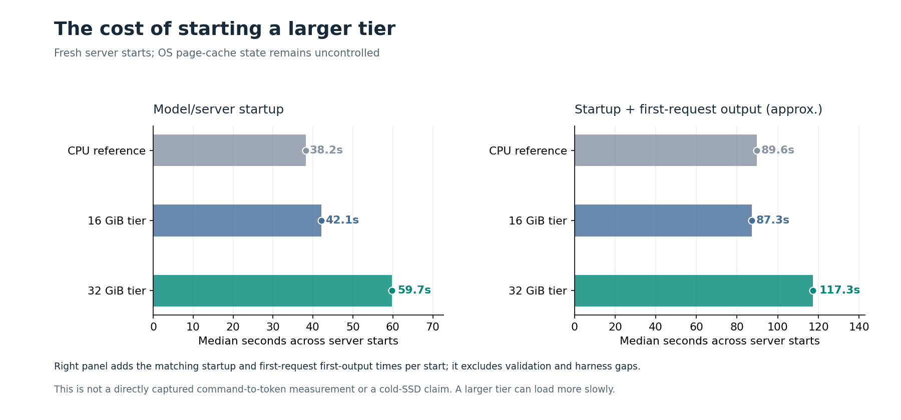
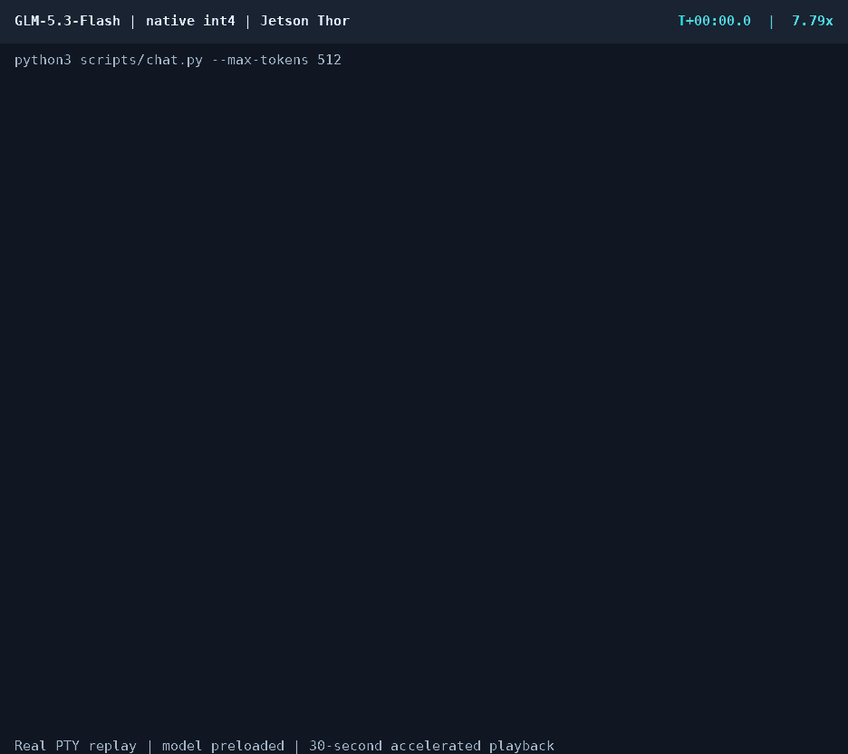

# Tunning-Enhance-1: 32 GiB GPU expert tier

Does increasing Colibri's CUDA expert tier from **16 to 32 GiB** improve native
GLM-5.3-Flash inference on Jetson Thor? The RAM expert cache stays at **32 decimal
GB**, and `COLI_CUDA_TC_GEMM=0` remains enabled as the validated workaround.

[Results](RESULTS.md) · [Method](METHODOLOGY.md) · [Reproduce](REPRODUCE.md) · [All study files](INDEX.md) · [Original study](../README.md)

<!-- STUDY STATUS START -->

**Status:** 7 recorded attempt(s), 3/3 complete pairs; **threshold_not_met**.

| Configuration | Independent starts | Median batch completion tok/s | Median server TTFT-proxy p50 | Answer checks |
|---|---:|---:|---:|---:|
| cpu-32 | 1 | 0.372 | 46.51 s | 2/2 |
| cuda-conservative-16-32 | 3 | 0.480 | 30.32 s | 6/6 |
| cuda-conservative-32-32 | 3 | 0.539 | 27.66 s | 6/6 |

**Paired median:** throughput +9.8%; TTFT-proxy reduction +9.3%. These compare fresh 32 GiB trials with fresh 16 GiB trials, not the historical session.

The completed measurements did not meet the predeclared considerable-gain target. The parent baseline remains unchanged; this study is documented without a headline upgrade or a new performance release under that rule.

<!-- STUDY STATUS END -->

## What is repeated?

- Native checkpoint inventory/geometry, two independent NumPy/C expert checks,
  the 46-case CUDA suite, and regression tests.
- One fresh CPU reference and three matched pairs of conservative 16/32 GiB
  CUDA starts. Four HTTP requests and two known-answer checks per start.
- Matched short/long raw-logit finiteness probes for CPU and both CUDA budgets.
- A new real Rust Fibonacci terminal recording using the 32 GiB configuration.

## Repeatability and cost

Each dot represents a fresh server start, not an independent request inside
one evolving cache. CPU/GPU allocations share physical RAM. Read the
[definitions and caveats](METHODOLOGY.md) before comparing systems.

## Startup trade-off

The right panel adds model/server startup to the first request's first-output
latency. It omits validation and harness gaps. More GPU residency can speed up
a loaded session while increasing the wait when starting one.

## 32 GiB GPU expert tier — 30-second Rust demo

<!-- DEMO START -->

The same prompt and output cap as the original demo, using this study's `scripts/chat.py`: **210.3 real seconds at 7.79×**, followed by a 3-second hold, for exactly 30 seconds. Model loading is excluded; this single demonstration is not the paired benchmark.

[Source/timing](results/rust-fibonacci-demo.json) · [Terminal output](results/rust-fibonacci-output.txt).

<!-- DEMO END -->

## Promotion rule

The criterion was fixed before observing results: at least **20% median paired
throughput improvement or TTFT-proxy reduction**, improving in all three pairs
for that metric, with no more than **5% median paired regression** in the other
metric. Every quality, finite-output, placement, memory, and container check must
pass. Every completed tuning is documented alongside the original benchmark in
the parent README, including small or negative results. Meeting this target can
also justify a new performance version; publication does not replace old data.
