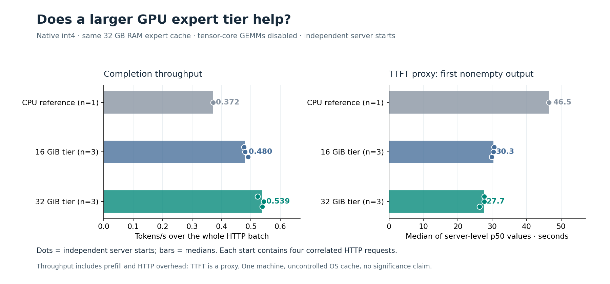
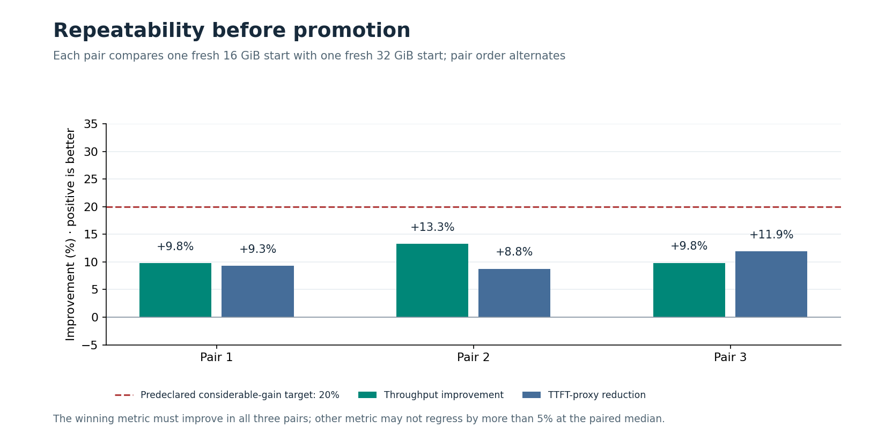
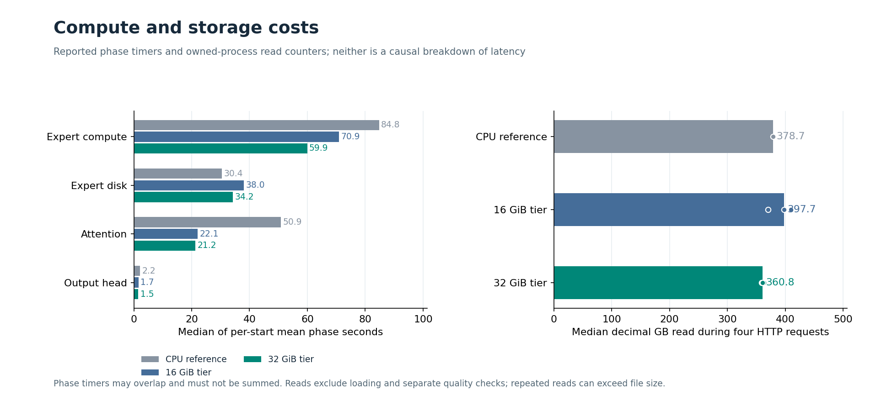
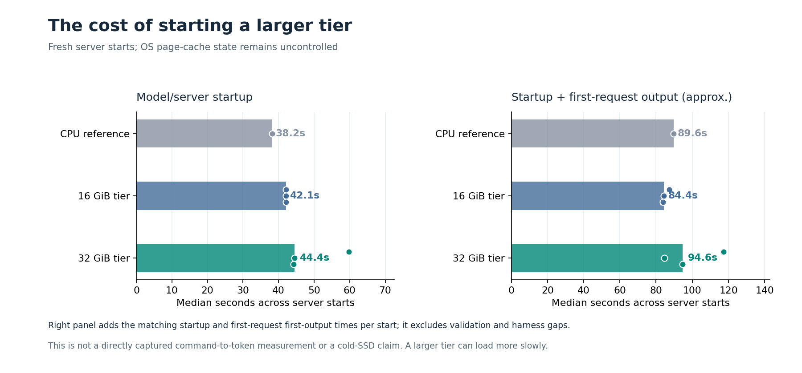

# Tunning-Enhance-1 results

Recorded 7 attempt(s); 3 complete comparison pair(s).

| Configuration | Starts | HTTP requests | Median batch tok/s | Median server TTFT-proxy p50 (s) | Answer checks |
|---|---:|---:|---:|---:|---:|
| cpu-32 | 1 | 4 | 0.372 | 46.51 | 2/2 |
| cuda-conservative-16-32 | 3 | 12 | 0.480 | 30.32 | 6/6 |
| cuda-conservative-32-32 | 3 | 12 | 0.539 | 27.66 | 6/6 |

## Paired improvements

| Pair | Throughput change | TTFT-proxy reduction |
|---|---:|---:|
| 1 | +9.8% | +9.3% |
| 2 | +13.3% | +8.8% |
| 3 | +9.8% | +11.9% |

## Memory, I/O, and startup trade-offs

| Measured cost | 16 GiB tier | 32 GiB tier |
|---|---:|---:|
| Median server startup | 42.06 s | 44.45 s |
| Approx. startup + first-request output | 84.42 s | 94.56 s |
| Lowest global available memory across starts | 52.36 GiB | 37.91 GiB |
| Median physical reads over four HTTP requests | 397.7 GB | 360.8 GB |
| Median per-start mean expert-compute timer | 70.93 s | 59.94 s |

The engine's device-served/routed share at the end of the HTTP stage rose from 40.1% to 52.2%. This is that counter's ratio, not a CPU-cache hit rate. More GPU residency accompanies less host expert work; these observations do not isolate a causal kernel speedup. Phase timers may overlap.

## Decision

**threshold_not_met**. Predeclared promotion threshold: at least 20% paired median improvement in throughput or first-output latency, improving in all three pairs for that metric, with no more than 5% paired median regression in the other metric; every correctness, placement, memory, and container check must pass.

## Visual evidence

The startup-plus-first-request panel adds matching per-start measurements and omits validation and harness gaps. It is not an exact command-to-token measurement. A throughput improvement can coexist with slower loading.

[Raw public metrics](results/summary.json) · [Method](METHODOLOGY.md) · [Reproduce](REPRODUCE.md) · [File index](INDEX.md)

## Limits

- One Thor and two short synthetic prompts; not a model quality benchmark
- Four requests within each server start are correlated; independent repetitions are server starts
- Three alternated pairs, uncontrolled OS page cache and concurrent user-service I/O; no cold-SSD or statistical-significance claim
- Only requested GPU expert-tier budget changes between the two CUDA profiles; shared UMA allocations still interact
- CPU reference is one fresh server start; historical baseline is context, not the tuning gain denominator
