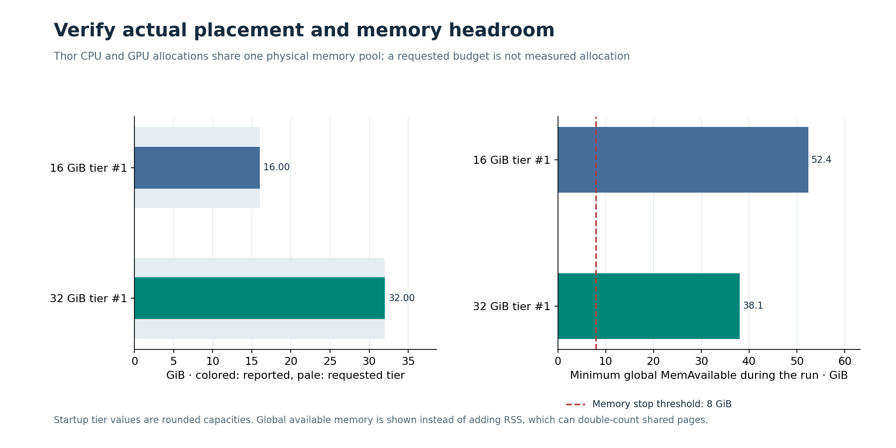

# Tunning-Enhance-1 results

Recorded 3 attempt(s); 1 complete comparison pair(s).

| Configuration | Starts | HTTP requests | Median batch tok/s | Median server TTFT-proxy p50 (s) | Answer checks |
|---|---:|---:|---:|---:|---:|
| cpu-32 | 1 | 4 | 0.372 | 46.51 | 2/2 |
| cuda-conservative-16-32 | 1 | 4 | 0.476 | 30.54 | 2/2 |
| cuda-conservative-32-32 | 1 | 4 | 0.523 | 27.71 | 2/2 |

## Paired improvements

| Pair | Throughput change | TTFT-proxy reduction |
|---|---:|---:|
| 1 | +9.8% | +9.3% |

## Decision

**pending_or_failed_checks**. Predeclared promotion threshold: at least 20% paired median improvement in throughput or first-output latency, improving in all three pairs for that metric, with no more than 5% paired median regression in the other metric; every correctness, placement, memory, and container check must pass.

## Visual evidence

[Raw public metrics](results/summary.json) · [Method](METHODOLOGY.md) · [Reproduce](REPRODUCE.md) · [File index](INDEX.md)

## Limits

- One Thor and two short synthetic prompts; not a model quality benchmark
- Four requests within each server start are correlated; independent repetitions are server starts
- Three alternated pairs, uncontrolled OS page cache and concurrent user-service I/O; no cold-SSD or statistical-significance claim
- Only requested GPU expert-tier budget changes between the two CUDA profiles; shared UMA allocations still interact
- CPU reference is one fresh server start; historical baseline is context, not the tuning gain denominator
