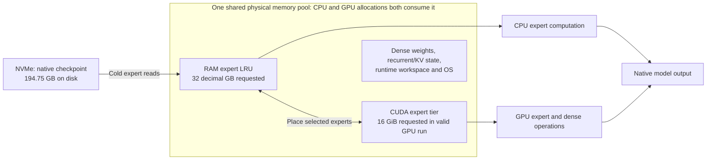
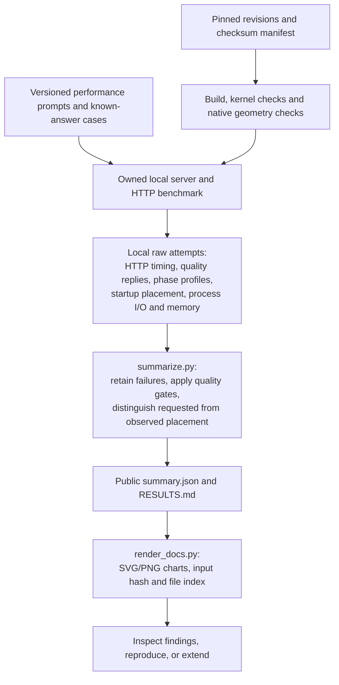
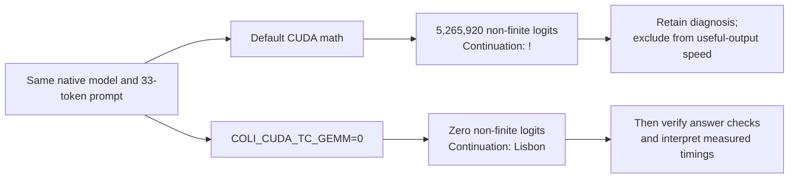

# Architecture and evidence flow

[Start](../README.md) · [Results](RESULTS.md) · [Reproduce](REPRODUCE.md) · [All files](INDEX.md)

## What is being tested?

The selected native checkpoint occupies approximately 194.75 decimal GB on NVMe.
The Thor has approximately 122.7 GiB of usable physical memory, shared by CPU
and GPU. The experiment therefore depends on partial expert residency and
repeated storage reads. It is not a fully resident 109 GB GGUF experiment.



This is a conceptual view of expert tiers. Dense-weight loading, transfers,
and eviction paths are not expanded into a complete engine call graph.

The CPU control disables GPU work while using the same CUDA-capable executable
and native checkpoint. The conservative CUDA configuration additionally sets
`COLI_CUDA_TC_GEMM=0`. Exact settings live in [profiles](../configs/profiles.json)
and [the runner](../scripts/run_experiment.py).

Budgets are requests, not measurements. The rejected CUDA run was clamped to
about 1.54 GiB; the later valid conservative run reported a 16.00 GiB device
expert tier. Both still consume the same physical memory pool as host buffers.
See [the resource chart](RESULTS.md#placement-and-storage-reads).

## How measurements become evidence



The charts use public committed summaries. Detailed local prompts/responses,
process identities, and full telemetry remain in the ignored raw-results
directory. The [file index](INDEX.md) links every published evidence file.

## The correctness gate matters



This isolates a problematic execution path on the pinned operating point. It
does not identify the exact faulty kernel or establish a general CUDA defect.
The [diagnostic record](DIAGNOSTICS.md) and [issue tracker](ISSUES_AND_PRS.md)
preserve that distinction.

## Rebuild the charts and file index

With Matplotlib already available:

```bash
python3 scripts/render_docs.py
```

Or use an optional, isolated documentation environment:

```bash
python3 -m venv .venv-docs
.venv-docs/bin/python -m pip install -r requirements-docs.txt
.venv-docs/bin/python scripts/render_docs.py
```

The renderer reads `results/summary.json`, not the 195 GB weights or local raw
logs. It creates three SVG and PNG charts, `docs/assets/figures.json`, and the
linked file index. The manifest records the source SHA-256 and local renderer
version. Layout and font details can vary across Matplotlib versions; the
data and metric definitions remain explicit.

After collecting new local runs, refresh the evidence first:

```bash
python3 scripts/summarize.py
python3 scripts/render_docs.py
```

On a fresh documentation-only clone, use the renderer directly. Summarizing
local attempts when no raw runs exist would replace the measured snapshot with
an empty local report. Stage any new public files before regenerating the
file index so the inventory includes them.
