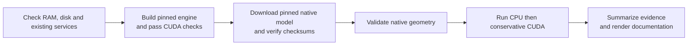

# Reproduce the study

Run commands from the repository root. The initial machine is a Jetson Thor
with about 122 GiB usable unified memory and CUDA 13.2. A different machine is
a new operating point and should have its own environment record.



For reading the results and rebuilding charts only, no model download is
needed: use [the documentation-only path](ARCHITECTURE.md#rebuild-the-charts-and-file-index).

## 1. Check resources and preserve existing services

```bash
df -h .
free -h
nvidia-smi
/usr/local/cuda/bin/nvcc --version
docker ps -a
```

Keep the protected large stopped model stopped during GLM inference. The
experiment itself neither starts nor stops any existing Docker container.
The initial runner requires at least 80 GiB available RAM and an unused local
port 8092. It monitors global available memory and terminates its own server
after three consecutive samples below 8 GiB. This is an operational guard,
not a proof that allocation failures are impossible.

## 2. Obtain and build the pinned engine

```bash
bash scripts/setup.sh
python3 scripts/capture_environment.py
```

The setup script clones only if the checkout is absent, checks its exact commit,
builds `glm53` for `sm_110`, runs the GLM CUDA correctness suite, and records
the binary hash. It refuses to replace a different source checkout.

Outputs: `logs/build-cuda.log`, `logs/cuda-glm53c-check.log`,
`results/build-validation.json`, `results/cuda-glm53c-check.txt`, and
`results/environment.json`. The main build and kernel check can take several
minutes. No operating-system packages are installed by the script.

## 3. Stage the native model

```bash
python3 scripts/download_model.py --manifest-only
python3 scripts/download_model.py --workers 4
```

This writes approximately 195 GB under `models/glm53-flash-int4-g64`. The
downloader checks free space including a 50 GiB reserve, pins the model revision,
checks content hashes, and records progress in `runtime/download-state.json`.
Rerun the same command to resume an interrupted download. Do not remove `.part`
files. New invocations use a lock to avoid writing the same files concurrently.

The initial setup started a detached download so it can outlive a terminal.
Use `python3 scripts/status.py` to inspect its state and PID. The command does
not silently skip checksum verification on an existing model; a fresh full
rerun can spend time verifying existing large files.

## 4. Validate the native container

```bash
python3 scripts/validate_model.py
```

This checks the completion manifest and every downloaded file's size, then
checks safetensors header bounds, nonoverlapping offsets, unique tensor names,
and native packed-int4/F32-scale geometry. It reads headers rather than loading
195 GB into RAM. Integrity and geometry checks do not establish answer quality.

An additional sampled arithmetic check uses the already installed NumPy and
compiles the upstream C container-check utility:

```bash
python3 scripts/check_native_expert.py
python3 -m unittest discover -s tests -v
```

The sampled check can run once a complete expert shard is present. It compares
two real gate/down projections against an independent NumPy decode, recording
tensor hashes and numerical errors. It does not mark the whole model ready.

## 5. Run the initial comparison

```bash
python3 scripts/run_experiment.py --profile cpu-32 --max-tokens 64 --repeats 2 --quality
python3 scripts/run_experiment.py --profile cuda-conservative-16-32 --max-tokens 64 --repeats 2 --quality
python3 scripts/summarize.py
python3 scripts/render_docs.py
```

Each command creates a fresh local server, waits for actual engine readiness,
runs the same two synthetic prompts twice through the upstream streaming HTTP
benchmark, and optionally sends two separate known-answer checks. The server
is stopped after that profile. The next profile does not overlap it.

The runner verifies its executable still matches the successful CUDA-check
hash. It records exact arguments, selected environment settings, workload hash,
HTTP attempts, engine phase profiles, quality responses, process-tree I/O,
RSS samples, global available memory, and container preservation checks.

The CUDA profile also requires positive routed-expert device execution in the
engine log. A GPU name in a startup banner is insufficient. Responses that
hit limits or fail checks remain in the raw record.

## 6. Optional unattended campaign

With the download already running, start the following in another terminal:

```bash
python3 -u scripts/campaign.py
```

The campaign waits for verified weights, validates the checkpoint, runs the two
profiles, and updates `results/summary.json` and `docs/RESULTS.md`. Its wait is
bounded at 24 hours; each HTTP smoke stage has a 40-minute cap, plus separate
bounded quality requests. It stops on a stage failure and generates the partial
report. It does not push or publish anything.

The resumed default order is CPU then conservative CUDA. The original default
CUDA run had non-finite logits; see [the diagnostic record](DIAGNOSTICS.md).
Use `--profiles` to select an explicit list for a later campaign.

```bash
python3 scripts/status.py
tail -f logs/campaign.log
```

The initial setup stores a detached campaign's log at that path. A foreground
invocation prints to its terminal instead.

To stop an owned job without touching other services:

```bash
python3 scripts/stop.py campaign
python3 scripts/stop.py download
```

The helper verifies each PID's command and workspace before signaling it. A
campaign interrupted during inference asks its runner to shut down that owned
server. `python3 scripts/stop.py server` can separately stop the recorded owned
server if needed. Resuming the download or campaign requires rerunning its
command; stopped work is not automatically restarted.

## 7. Inspect and curate results

Raw run folders under `results/raw/` contain `run.json`, `server.log`,
`client.log`, `http.json`, `engine-profile.json`, `telemetry.jsonl`, and optional
`quality.json`. Inspect raw files before drawing conclusions. RSS sums can
double-count shared pages; the physical-memory constraint is better understood
using global available memory alongside them.

The curated summary omits absolute commands and local process identities.
Weights, raw logs, runtime state, the local PDF, and unrelated administration records
are ignored by Git. Review staged files before publishing your portfolio.

## 8. Local Git preparation

This workspace can become a new local repository. No remote is created and no
changes are pushed automatically. Once a destination is selected, review the
tracked files and commit the methods and measured evidence you want to share.
