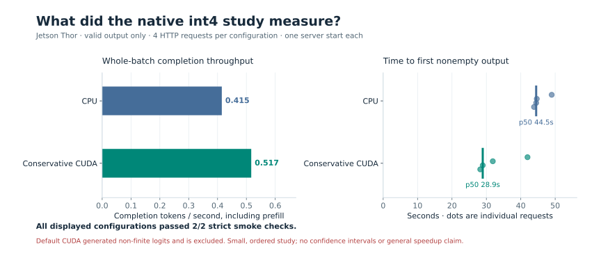
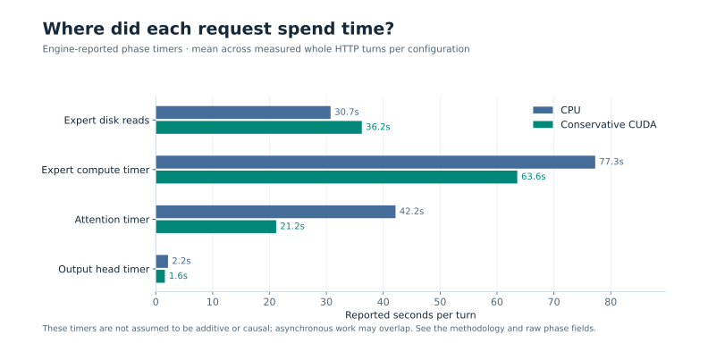
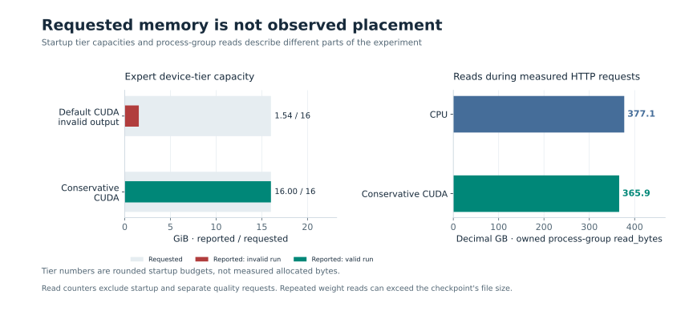

# Results

These are initial measurements on one Thor. Failed attempts remain in the dataset.

The build and GLM CUDA correctness evidence is in [build-validation.json](../results/build-validation.json).

| Run | Status | Profile | Smoke checks | Reported device tier (GiB) | HTTP completion tok/s | First-output p50 (s) | Disk reads (GB) |
|---|---|---|---|---:|---:|---:|---:|
| 20261125T091731Z-cuda-16-32 | invalid_output | cuda-16-32 | 0/2 | 1.540 | unavailable | 4.278 | 3.969 |
| 20261125T154401Z-cpu-32 | complete | cpu-32 | 2/2 | not applicable | 0.415 | 44.472 | 377.064 |
| 20261125T155700Z-cuda-conservative-16-32 | complete | cuda-conservative-16-32 | 2/2 | 16.000 | 0.517 | 28.940 | 365.875 |

Invalid-output timings are excluded from the headline throughput column; raw diagnostic rates remain in JSON.

HTTP throughput includes the whole measured batch. It must not be compared directly with steady-decode benchmarks.

See [summary.json](../results/summary.json) for per-attempt metrics, memory, integrity checks, and limitations.

## Measured performance

In the initial 2026-11-25 study, CPU measured 0.415 completion tok/s and conservative CUDA measured 0.517. Both passed 2/2 strict smoke checks. First nonempty output p50 was 44.5 s and 28.9 s respectively. These rates make that operating point a slow interactive experiment; they do not establish a general model or hardware ranking.

The throughput bars include prefill and HTTP overhead. The latency dots are four requests within one server start per configuration, not independent benchmark trials. Default CUDA produced invalid output and is excluded from the speed comparison.

## Reported phase times

The expert-compute timer is the largest of the four displayed counters in both valid configurations. Conservative CUDA reported lower expert-compute and attention times, while its expert-disk timer was higher. These are whole-configuration observations: residency, cache state, and compute all differ. Timers may overlap and are not added into a wall-time breakdown.

## Placement and storage reads

Both CUDA attempts requested a 16 GiB expert tier. The rejected attempt reported only 1.54 GiB at startup; the valid conservative attempt reported 16.00 GiB. This is rounded engine-reported capacity, not measured allocated bytes. The exact cause of the earlier clamp remains unproven.

The valid CPU and CUDA runs read approximately 377.1 GB and 365.9 GB during their four measured HTTP requests. These process-group counters exclude startup and separate quality checks. Repeated reads can exceed the 194.75 GB checkpoint size; the counters do not measure unique bytes or SSD bandwidth.

## Inspect or reproduce

- [Architecture and evidence flow](ARCHITECTURE.md): how SSD, shared memory, and correctness gates fit together.
- [Reproduction guide](REPRODUCE.md): exact setup and benchmark commands.
- [Methodology](METHODOLOGY.md): metric definitions and comparison limits.
- [Diagnostics](DIAGNOSTICS.md) and [issues/fixes](ISSUES_AND_PRS.md): evidence behind the conservative CUDA workaround.
- [Complete file index](INDEX.md): every public file and its purpose.

Charts are generated from [summary.json](../results/summary.json) by [render_docs.py](../scripts/render_docs.py). The [figure manifest](assets/figures.json) records the source SHA-256 and plotting version; SVG and PNG exports are committed. Regenerate from the saved summary with `python3 scripts/render_docs.py` without downloading weights.

These interpretation paragraphs describe the saved initial study. Revisit them when publishing a new campaign; the table and charts regenerate from data.

## Limits

- One machine and two short synthetic prompts; not a model intelligence benchmark
- I/O policy is recorded per attempt; the initial native-default direct-I/O run was mislabeled in its original metadata and is corrected in the curated summary
- Initial default CUDA failed numerically; valid comparison order was CPU then conservative CUDA, so cache state and drift can confound comparisons
- CPU and GPU profiles differ in device expert capacity as well as compute; no isolated GPU-kernel speedup claim
- Quality checks are two strict known-answer smoke tests, not a general quality score
